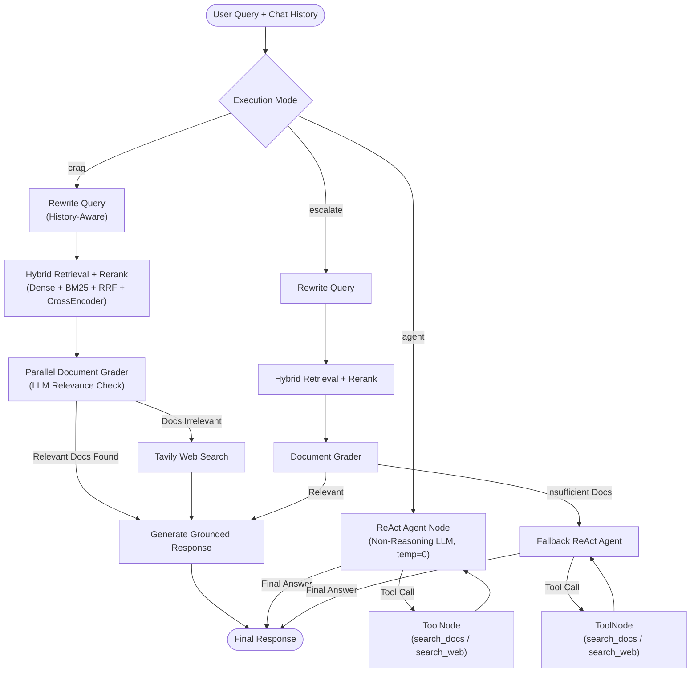

# Trimodal Adaptive RAG

A production-oriented **Tri-Modal Agentic & Corrective RAG** platform built with **LangGraph**, **ChromaDB**, **BM25s**, **Cross-Encoder Reranking**, and **SQLite Checkpointing**. Designed for high-precision multi-document QA with configurable execution modes (**CRAG**, **Agentic ReAct**, and **Adaptive Escalate**) and systematically benchmarked on a 60-question evaluation suite.


---

## 1. Core Problems & Solutions

* **Multi-Turn Context Loss:** Follow-up questions with pronoun ambiguity (e.g., *"What is its complexity?"*) degrade direct vector search. Solved via a **History-Aware Query Rewriter** backed by persistent SQLite thread state.
* **Cross-Document Contamination:** Indexing multiple PDFs globally introduces semantic noise. Solved via **Metadata-Filtered Retrieval (`selected_files`)**, allowing users and agents to scope search dynamically to specific documents.
* **Dense Retrieval Ceiling:** Pure dense embeddings struggle with exact lexical terms, acronyms, and numbers. Solved via **Contextual Chunk Enrichment**, **Hybrid Search (Dense + BM25s via RRF)**, and **Cross-Encoder Reranking** (`ms-marco-MiniLM-L-6-v2`).
* **Out-of-Scope Hallucinations & Rigid Pipelines:** Single-pass RAG either hallucinates on missing context or fails on multi-hop questions. Solved via **Corrective Document Grading (CRAG)**, **Tavily Web Fallback**, and an **Adaptive Escalation Gateway** that hands off failed retrievals to an autonomous **ReAct Agent**.

---

## 2. Tri-Modal Architecture

The system exposes three distinct reasoning architectures through a unified factory (`src/main.py` -> `get_pipeline(mode)`):

| Mode | Architecture | Best For |
| :--- | :--- | :--- |
| **`crag`** | **Corrective RAG (Single-Pass)** | Fast, deterministic document QA with parallel chunk grading and web fallback. |
| **`agent`** | **Pure ReAct Agent (Multi-Hop)** | Complex cross-document comparisons and multi-step reasoning via tool calling. |
| **`escalate`** | **Adaptive Hybrid Escalation** | Balanced production default: takes the fast CRAG path first and escalates to the ReAct Agent only if document grading fails. |



---

## 3. Tech Stack

| Layer | Technology | Role |
| :--- | :--- | :--- |
| **Orchestration** | **LangGraph** (`StateGraph`, `ToolNode`) | Cyclic agent loops, conditional routing, and state persistence. |
| **LLM Engine** | **OpenAI** (Non-Reasoning LLM) | Configured with `temperature=0.0` and `reasoning_effort="none"` for strict context adherence, tool calling, and low inference cost. |
| **Embeddings & Vector Store** | `text-embedding-3-small` + **ChromaDB** | Persistent dense vector index with metadata filtering. |
| **Sparse Retrieval & Rerank** | **BM25s** + **Cross-Encoder** | Lexical matching fused via RRF (`k=20`), reranked to `top_k=3` with `ms-marco-MiniLM-L-6-v2`. |
| **Ingestion & Enrichment** | **PyMuPDF** + **Contextual Retrieval** | SHA-256 deduplication, recursive chunking (`1000/200`), and parallel chunk context enrichment. |
| **Web Search** | **Tavily** (`langchain-tavily`) | Out-of-scope web fallback with deterministic record-and-replay caching for reproducible evals. |
| **Persistence & UI** | **SQLite Checkpointer** + **Streamlit** | Thread-safe `AsyncFriendlySqliteSaver` bridging synchronous SQLite reads with async `app.astream()` execution. |

---

## 4. Evaluation & Benchmark Results

### Methodology
* **Dataset:** 60 test queries across 3 papers (`arxiv1.pdf`, `arxiv2.pdf`, `arxiv3.pdf`) — 50 document questions, 10 out-of-scope questions, and 20 multi-turn follow-ups.
* **Independent Judge:** Scored on a 1–5 scale using **`gpt-5.4-mini`** (`temperature=0.0`) as an independent judge separate from the **`gpt-6-luna`** generator (`temperature=0.0`, `reasoning_effort="none"`).
* **Execution:** Async evaluation (`asyncio.Semaphore`) with `recursion_limit=20` (0% error rate across all 60 queries), tracking tool calls, escalation rate, latency, and tokens.

### Current Production Benchmarks (`gpt-6-luna` Generator · `gpt-5.4-mini` Judge · 60/60 Valid)

| Architecture / Mode | Faithfulness (0-5) | Relevance (0-5) | Multi-Turn (F / R) | Avg Gen Latency | P95 Gen Latency | Avg RAG Tokens / Query | Est. RAG Cost / Query | Tool Calls / Escalation |
| :--- | :---: | :---: | :---: | :---: | :---: | :---: | :---: | :--- |
| **CRAG (Single-Pass)** | **4.82** | 4.83 | **5.00 / 5.00** | **9.42 s** | **14.18 s** | **2,367** | **~$0.00029** | 0.00 tools · 21.7% web (`13/60`) |
| **Pure ReAct Agent (Multi-Hop)** | 4.72 | 4.97 | 4.85 / 5.00 | 10.65 s | 35.29 s | 3,628 | ~$0.00043 | 1.38 tools (`82` docs, `1` web) |
| **Adaptive Escalate (Sufficiency-Aware)** | **4.82** | **4.98** | **5.00 / 5.00** | 12.94 s | 27.53 s | 4,432 | ~$0.00051 | 0.73 tools · 30.0% escalated (`18/60`) |

> *Generation costs are estimated from recorded `rag_tokens` (`gpt-6-luna`: `$0.10 / 1M` input, `$0.50 / 1M` output). Judge cost (`gpt-5.4-mini`) was `~$0.10–$0.14` per 60-query run. Full per-category breakdown and earlier `gpt-6-luna` judge runs are in [decisions.md](decisions.md).*

### Key Engineering Findings
1. **Latency vs. Completeness Trade-off:**
   * **CRAG** is the fastest and cheapest mode (**9.42 s** avg, **14.18 s** P95). It gets **5.00** on `direct`, `factual`, and `multi_turn_followup`, but struggles on `comparative` questions (**4.14** Faithfulness, **4.29** Relevance) when one search misses part of the comparison.
   * **Pure ReAct Agent** handles `comparative` (**4.71 / 5.00**) and `reasoning` (**4.67 / 5.00**) well through multi-step tool calls, but has higher tail latency (**35.29 s** P95) and weaker `out_of_scope` restraint (**4.30** Faithfulness).
   * **Adaptive Escalate** checks both chunk relevance and overall context sufficiency (`SufficiencyEvaluator`). It handles 70% of queries on the fast CRAG path (keeping **5.00** Multi-Turn and **4.70** Out-of-Scope) and escalates on incomplete/comparative queries (**85.7%** on `comparative`). This gives the top overall **Relevance (4.98)** and **Faithfulness (4.82)** with lower P95 latency than Pure Agent (**27.53 s** vs **35.29 s**). Trade-off: when 30% of queries escalate, running CRAG + Agent back-to-back makes average latency (**12.94 s**) and tokens (**4,432**/query) higher than Pure Agent.
2. **Non-Reasoning Settings (`reasoning_effort="none"`):**
   * Reasoning models often add extra outside knowledge beyond the retrieved text, which lowers faithfulness scores, and reject `temperature=0.0`. Setting `reasoning_effort="none"` keeps outputs grounded at `temp=0.0`, works cleanly with tool calling, and stays on the `$0.10 / $0.50` pricing tier.

> *For full architectural trade-offs, ablation studies, and historical benchmarks (V1–V5), see [decisions.md](decisions.md) and [`eval/benchmarks/`](eval/benchmarks/).*

---

## 5. Project Structure

```text
trimodal-adaptive-rag/
├── app_gui.py                         # Streamlit UI (3 modes + AsyncFriendlySqliteSaver)
├── decisions.md                       # Architectural decisions & full benchmark history
├── requirements.txt                   # Pinned dependencies
├── .env.example                       # API key template
│
├── src/
│   ├── main.py                        # Unified CLI entrypoint & get_pipeline() factory
│   ├── config.py                      # Centralized model, retrieval & path settings
│   ├── prompt.py                      # Rewriter, Grader, and Synthesis prompts
│   ├── utils.py                       # Document formatting, hashing & history helpers
│   ├── ingestion/
│   │   └── ingestion.py               # PyMuPDF + Contextual Chunking + Dual Indexing
│   ├── retrieval/
│   │   ├── bm25.py                    # BM25s sparse retriever
│   │   ├── hybrid_search.py           # RRF fusion retriever
│   │   ├── reranker.py                # Cross-Encoder reranking
│   │   ├── pipeline.py                # Unified retrieve_and_rerank() pipeline
│   │   └── web.py                     # Tavily search + deterministic replay cache
│   ├── graph/
│   │   ├── state.py                   # Shared CRAG/Escalate state schema
│   │   ├── nodes.py                   # Rewrite, Retrieve, Grade, Web, Generate & Fallback nodes
│   │   ├── crag.py                    # Mode 1: CRAG StateGraph
│   │   └── escalate.py                # Mode 3: Adaptive Escalate StateGraph
│   └── agent/
│       ├── agent_state.py             # ReAct agent state schema
│       ├── agent_prompt.py            # Boundary-aware agent system prompt
│       ├── tools.py                   # Scoped search_docs & search_web tools
│       ├── nodes.py                   # Tool-bound agent node
│       └── pipeline.py                # Mode 2: ReAct Agent StateGraph
│
├── eval/
│   ├── retrieval/                     # Hit Rate & MRR retrieval benchmarks
│   ├── generation/
│   │   ├── gen_evaluation.py          # Async LLM-as-a-Judge harness (--mode)
│   │   ├── prompts.py                 # Judge rubric & structured prompt
│   │   └── schemas.py                 # Pydantic schemas (RunMetadata, CRAGTelemetry)
│   └── benchmarks/                    # Archived JSON reports (V1 to V5)
│
└── data/
    ├── arxiv1.pdf, arxiv2.pdf, arxiv3.pdf
    ├── ground_truth.json              # 60-query evaluation dataset
    └── tavily_search_results.json     # Cached web search responses
```

---

## 6. Quickstart & Usage

### Prerequisites
* Python 3.10+
* OpenAI API Key
* Tavily API Key

### Installation
```bash
# 1. Clone the repository
git clone https://github.com/denizzozupek/trimodal-adaptive-rag.git
cd trimodal-adaptive-rag

# 2. Create and activate a virtual environment
python -m venv .venv
# Windows:
.venv\Scripts\activate
# Linux/macOS:
source .venv/bin/activate

# 3. Install dependencies
pip install -r requirements.txt

# 4. Configure environment variables
cp .env.example .env
# Add your OPENAI_API_KEY and TAVILY_API_KEY inside .env
```

### First-Time Document Ingestion
On a fresh clone, the local indexes (`data/vector_db/`, `data/bm25_index/`) and conversation store (`data/graph.db`) do not exist yet—they are generated automatically when you ingest your first document.

* **Option A — Upload via Streamlit UI (Recommended):** Launch `streamlit run app_gui.py` and upload any PDF file(s) from the sidebar. The app automatically computes SHA-256 hashes (preventing duplicate embeddings), enriches chunks with document context, and builds both the ChromaDB vector store and BM25s index.
* **Option B — Ingest via CLI (Before running `src.main`):**
  ```bash
  # Ingest your own PDF file
  python -m src.ingestion.ingestion --pdf path/to/your_document.pdf

  # Or ingest the included sample paper (default)
  python -m src.ingestion.ingestion
  ```

### Running the Streamlit UI
```bash
streamlit run app_gui.py
```
Select between **CRAG**, **Agentic**, or **Escalate** directly from the sidebar, upload PDFs, scope specific files, and persist conversations across sessions via SQLite.

### Running via Unified CLI
```bash
# Interactive chat in Escalate mode
python -m src.main --mode escalate

# Single query with step-by-step node streaming
python -m src.main --mode agent --query "Compare the price of anarchy definitions across documents" --stream
```

### Running the Evaluation Suite
```bash
# Evaluate CRAG, Agent, or Escalate mode across all 60 queries
python -m eval.generation.gen_evaluation --mode crag
python -m eval.generation.gen_evaluation --mode agent
python -m eval.generation.gen_evaluation --mode escalate
```

---

## 7. Future Roadmap

* **Read-Only MCP Server (`FastMCP` / `stdio`):** Expose the hybrid retrieval layer (`search_documents`, `list_documents`) as a lightweight local MCP server so clients like Claude Desktop and Cursor can query indexed documents directly.
  * **Planned Scope:** Kept **read-only** (document ingestion stays in the CLI and Streamlit UI to avoid long tool timeouts and accidental API costs) and designed for **single-user local setups** without per-user permission filtering.
